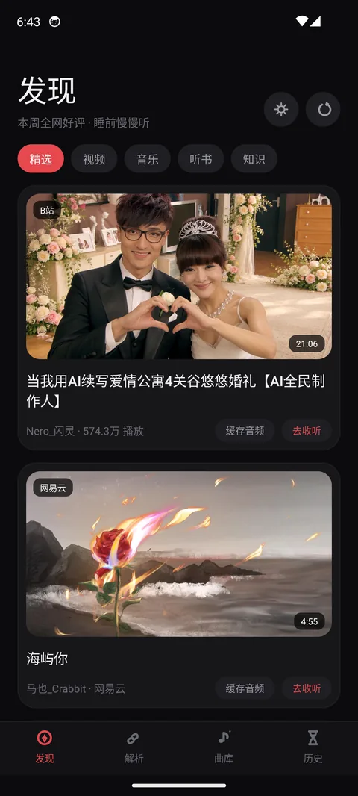
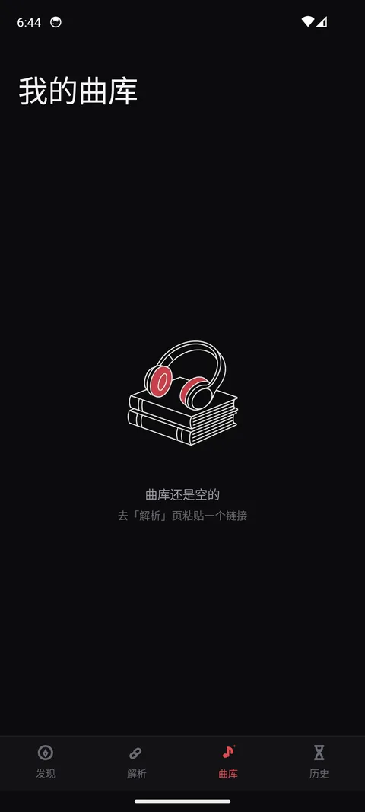
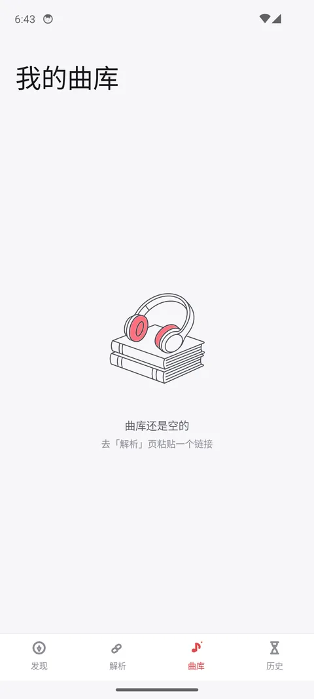

# 睡前听 · AudioSleep

**本周值得听的内容，一屏发现；想离线听，一键缓存。**

<p>
  
  
  
  
  
</p>

---

## 这是什么

一个 Android 睡前音频 App，两个功能，主次分明：

| 优先级 | 功能 | 说明 |
|---|---|---|
| **主** | **发现** | 聚合本周热门视频 / 音乐 / 有声内容，按分类浏览；点卡片直达对应 App，点「缓存」把音频存到本地 |
| **副** | **解析** | 粘贴分享链接，只保留音轨存成 `.m4a`，离线播放 + 睡眠定时 |

只处理**公开免费内容**；付费、会员、充电专属内容会被明确拒绝，不做任何绕过。

---

## 界面

| 夜间 | 白天 |
|---|---|
|  |  |

| 空曲库（夜间） | 空曲库（白天） |
|---|---|
|  |  |

- 大标题 + 圆角卡片 + 单一强调色的 iOS 风格
- 底部四标签：**发现 / 解析 / 曲库 / 历史**
- 迷你播放条常驻，全屏播放页支持拖动进度与睡眠定时
- **黑夜 / 白天模式一键切换**，状态栏、插画、卡片全部跟随

---

## 功能

### 发现（主功能）

| 能力 | 说明 |
|---|---|
| 分类聚合 | **精选 / 视频 / 音乐 / 听书 / 知识**，多榜单交叉排列不留单一榜单痕迹 |
| 真实数据 | 每周热度、播放量、时长、封面全部来自公开数据源，30 分钟缓存，断网可读 |
| 一键直达 | 点卡片进入详情，点「去 App 收听」用 `ACTION_VIEW` 拉起对应 App（未安装则用浏览器） |
| 一键缓存 | 详情页「缓存音频」回到解析页自动解析，无需重复粘贴 |
| 下拉刷新 | 手势刷新当前分类 |
| 编辑精选兜底 | 接口不可用时自动加载内置的 26 条精选内容，永远不会白屏 |

### 解析（副功能）

- 支持长视频 / 短视频 / 有声书分享链接，以及任意公开媒体直链的网页
- 只保留音轨：体积约为原视频的 1/10
- **HLS 支持**：m3u8 播放列表会合并为单个本地文件后再抽音轨

### 播放

- 后台播放 + 通知栏控制（前台服务）
- 睡眠定时 15 / 30 / 45 / 60 分钟
- 进度记忆、断点续播
- 迷你播放条 + 全屏播放器

### 其他

- 历史记录：每次解析都记录状态（已解析 / 已下载 / 失败），可一键重新解析
- 曲库：本地音频列表，支持删除与进度显示
- 封面：按标题哈希生成固定配色，无网络也能有辨识度
- 零权限：不要存储权限，不收集个人信息，无账号体系

---

## 架构

```
┌──────────────── 发现（主） ────────────────┐
│ FeedService  → 多榜单聚合 + 30 分钟缓存      │
│ FeedAdapter  → 卡片列表 + 轻量图片加载       │
│ 点击 → 详情页 → 拉起外部 App / 回流解析       │
└──────────────────┬─────────────────────────┘
                   │
┌──────────────────▼─────────────────────────┐
│ Resolver → Downloader → AudioExtractor      │
│            （HLS 时先合并分片）               │
└──────────────────┬─────────────────────────┘
                   │
        ┌──────────┴──────────┐
        ▼                     ▼
   曲库 Library          历史 History
        │
        ▼
   PlayerService → 全屏播放器 / 迷你播放条
```

### 解析器

```kotlin
interface Resolver {
    fun canHandle(url: String): Boolean
    suspend fun resolve(url: String): ResolveResult
}
```

| 实现 | 负责 |
|---|---|
| `PrimaryResolver` | 长视频页：元数据接口 + 纯音频音轨 |
| `SecondaryResolver` | 短视频分享页：页面内嵌 JSON |
| `AudioBookResolver` | 有声/音频平台：曲目信息 + 现成音频地址 |
| `WebPageResolver` | 通用兜底：OG 标签 / `<video>` / 直链 `.mp4/.m4a/.m3u8` |

`ResolveResult` 只带下游需要的两个事实：`audioOnly`（是否已是纯音频）、`hls`（是否需要合并播放列表）。

---

## 技术栈

| 层 | 选型 |
|---|---|
| 语言 | Kotlin 1.9 + Coroutines |
| UI | AppCompat + RecyclerView（无 Compose） |
| 网络 | OkHttp 4.12 |
| 图片 | 自研 LRU 加载器（无 Glide/Picasso） |
| 解封装 | `MediaExtractor` + `MediaMuxer`（无 ffmpeg） |
| 播放 | `MediaPlayer` + 前台 Service |
| 存储 | 应用私有文件 + SharedPreferences(JSON) |
| 主题 | `values` / `values-night` 双色板 + AppCompatDelegate |
| 构建 | AGP 8.5 · Gradle 8.7 · JDK 17 |

---

## 下载安装

到 [Releases](../../releases) 页面下载最新的 `AutoAudio-1.0.apk`，或在仓库内取 `dist/AutoAudio-1.0.apk`。

安装：允许「安装未知来源应用」后打开 APK。这是 debug 签名包，未上架应用商店属于正常现象。

**系统要求**：Android 8.0（API 26）及以上。

---

## 从源码构建

```bash
git clone https://github.com/Raz3d1/autoaudio.git
cd autoaudio

# 1. 配置 SDK 路径（该文件不入库）
cp local.properties.example local.properties
# 编辑：sdk.dir=/你的/Android/Sdk

# 2. 构建
./gradlew assembleDebug        # macOS / Linux
gradlew.bat assembleDebug      # Windows

# 产物：app/build/outputs/apk/debug/app-debug.apk
```

需要 JDK 17、Android SDK Platform 34 + Build-Tools 34.0.0。

---

## 目录结构

```
autoaudio/
├── app/src/main/
│   ├── java/com/audiosleep/
│   │   ├── App.kt                     # 启动时应用主题
│   │   ├── MainActivity.kt            # 四标签 + 发现流 + 迷你播放条
│   │   ├── FeedDetailActivity.kt      # 推荐详情页
│   │   ├── PlayerActivity.kt          # 全屏播放器
│   │   ├── data/                      # FeedItem / AudioItem / Library / History
│   │   ├── media/                     # Downloader / AudioExtractor / PlayerService
│   │   ├── net/                       # FeedService / HlsDownloader / 4 个 Resolver
│   │   ├── ui/                        # FeedAdapter / AudioAdapter / HistoryAdapter
│   │   └── util/                      # ImageLoader / Cover
│   ├── assets/editor_picks.json       # 编辑精选兜底数据
│   └── res/
│       ├── drawable/                  # 矢量图标、空状态插画（白天）
│       ├── drawable-night/            # 空状态插画（夜间）
│       ├── layout/                    # 页面布局
│       ├── values/                    # 白天色板 / 主题
│       └── values-night/              # 夜间色板 / 主题
├── docs/
│   ├── ARCHITECTURE.md                # 架构说明
│   └── screenshots/                   # README 截图
├── dist/AutoAudio-1.0.apk             # 预编译安装包
└── gradle/wrapper/                    # Gradle Wrapper
```

---

## 限制

- **仅公开内容**：付费 / 会员 / DRM / 充电专属内容会被拒绝并提示，不做绕过
- **数据源有限**：发现页目前聚合两个平台的公开榜单；没有公开榜单接口的平台无法接入
- **脚本渲染页面**：通用解析器读不到纯 JS 动态注入的媒体地址，会明确报错
- **不转码**：输出沿用源码率（AAC / `.m4a`），不转 MP3
- **无账号体系**：数据仅存本机，卸载即清空

---

## 免责声明

本项目仅供**个人离线收听公开内容**使用。App 不托管、不打包、不再分发任何媒体文件，也不绕过任何付费或访问控制。下载行为可能仍与平台用户协议冲突，请自行判断并承担使用后果。

---

## 许可证

[MIT](LICENSE)
